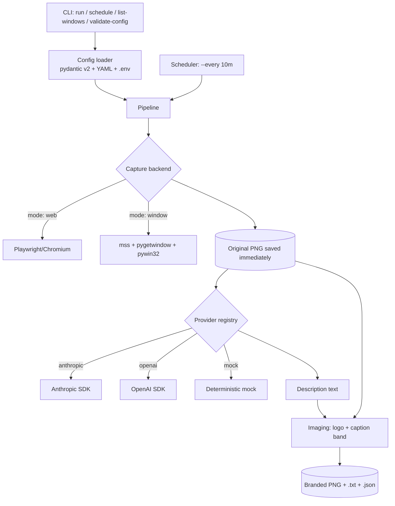
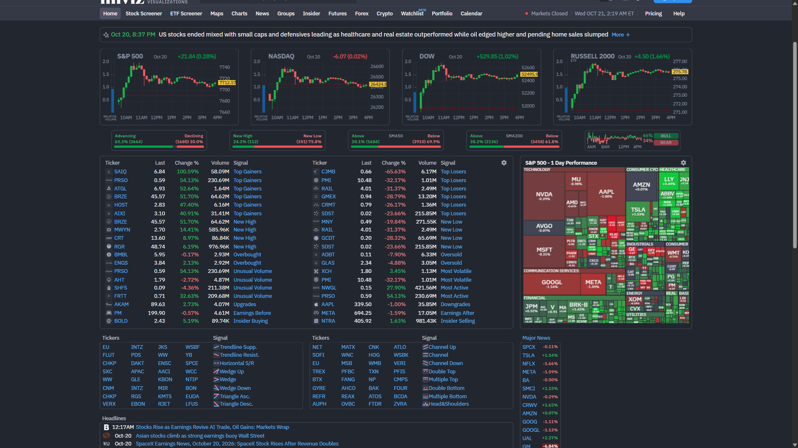
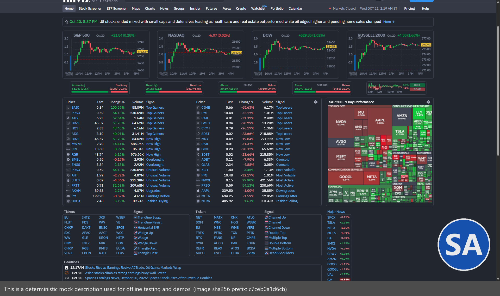

# Screenshot Scene-Description Agent

A Python CLI that captures a screenshot (Finviz by default, or any desktop window), asks a
vision-capable LLM to describe what's happening in the scene, and produces a branded copy
(logo + caption) alongside the original, a text file, and a JSON metadata record.

## Quickstart

```powershell
git clone <this-repo-url>
cd "Screenshot Scene-Description Agent"
python -m venv .venv
.\.venv\Scripts\Activate.ps1
pip install -e ".[dev]"
playwright install chromium
copy .env.example .env          # then fill in ANTHROPIC_API_KEY or OPENAI_API_KEY
copy config\config.example.yaml config\config.yaml

# One command, mock provider, no API key required:
scene-agent run --config config\config.yaml --provider mock
```

Outputs land in `data/input/` (original) and `data/output/` (branded PNG + `.txt` + `.json`).

## Overview

1. Playwright (Chromium) captures a screenshot of a URL, or `mss`/`pygetwindow`/`pywin32`
   capture an existing desktop window (Windows only).
2. The ORIGINAL screenshot is saved immediately, untouched, before any network call.
3. A copy (downscaled only if needed) is sent to a vision LLM with an editable prompt.
4. The returned description is stamped onto a *separate* branded copy together with a logo,
   as a caption band sized to the text.
5. Four artifacts are written: original PNG, branded PNG, `.txt`, `.json` (run metadata).

## Architecture



Module layout (`src/scene_agent/`):

| Module | Responsibility |
|---|---|
| `config.py` | Pydantic v2 models + YAML loader + CLI-flag overrides |
| `errors.py` | Custom exception hierarchy + error-code taxonomy + secret redaction |
| `logging_setup.py` | Console + rotating file logging, per-run `run_id` |
| `capture/base.py`, `web.py`, `window.py` | Shared capture interface, Playwright backend, desktop-window backend |
| `providers/base.py`, `registry.py`, `anthropic_provider.py`, `openai_provider.py`, `mock_provider.py` | Vision-LLM interface, retry helper, registry, implementations |
| `imaging/logo.py`, `caption.py` | Pillow logo compositing and caption-band rendering |
| `artifacts.py` | Collision-safe naming, SHA-256, JSON/TXT writers |
| `pipeline.py` | Orchestrates capture -> save -> describe -> brand -> persist |
| `scheduler.py` | Interval loop, no overlapping runs, survives failures |
| `cli.py` | argparse entry point: `run`, `schedule`, `list-windows`, `validate-config` |

## Prerequisites

- Windows 10/11
- Python 3.11+
- Git

## Setup

```powershell
python -m venv .venv
.\.venv\Scripts\Activate.ps1
pip install -e ".[dev]"
playwright install chromium
```

If `playwright install chromium` fails to resolve `playwright.download.prss.microsoft.com` on
a restricted network, retry with the CDN mirror (this was required in the development
environment used to build this project):

```powershell
$env:PLAYWRIGHT_DOWNLOAD_HOST = "https://cdn.playwright.dev"
playwright install chromium
```

Copy the config and env templates:

```powershell
copy config\config.example.yaml config\config.yaml
copy .env.example .env
```

Edit `.env` with your real key(s). **Never commit `.env`.**

## Config reference

All options live in one YAML file (`config/config.example.yaml` has a comment on every field).

| Key | Default | Meaning |
|---|---|---|
| `paths.input_dir` | `data/input` | Folder for original screenshots (auto-created) |
| `paths.output_dir` | `data/output` | Folder for branded PNG/TXT/JSON (auto-created) |
| `paths.log_dir` | `logs` | Folder for rotating log file (auto-created) |
| `capture.mode` | `web` | `web` (Playwright) or `window` (desktop capture, Windows only) |
| `capture.web.url` | `https://www.finviz.com` | Page to capture |
| `capture.web.viewport_width/height` | `1920x1080` | CSS viewport size |
| `capture.web.full_page` | `false` | Full scrollable page vs. viewport only |
| `capture.web.timeout_ms` | `30000` | Hard cap for navigation + readiness waits |
| `capture.web.headless` | `false` | See [Troubleshooting](#troubleshooting) - Finviz blocks headless Chromium |
| `capture.web.settle_delay_ms` | `3000` | Extra wait after DOMContentLoaded for late JS/ads |
| `capture.web.ready_selector` | `null` | Optional CSS selector to wait for (best-effort, times out safely) |
| `capture.web.dismiss_consent_selectors` | common cookie-banner selectors | Best-effort click list |
| `capture.window.title` / `process_name` | `null` | Match an existing window (one required if `mode: window`) |
| `capture.window.timeout_ms` | `5000` | How long to search for the window |
| `provider.name` | `anthropic` | `anthropic` \| `openai` \| `nvidia` \| `mock` |
| `provider.prompt` | "Read this image and explain exactly what is happening in this scene." | Editable prompt |
| `provider.timeout_s` | `60` | Per-attempt request timeout |
| `provider.max_retries` | `3` | Total attempts for transient errors |
| `provider.anthropic.model` | `claude-sonnet-4-20250514` | **Re-verify against Anthropic docs** |
| `provider.openai.model` | `gpt-4o` | **Re-verify against OpenAI docs** |
| `provider.nvidia.model` | `meta/llama-3.2-11b-vision-instruct` | NVIDIA API Catalog (OpenAI-compatible). Alt: `nvidia/nemotron-3.5-super-vl-120b-a12b` (larger MoE, likely slower). **Re-verify against build.nvidia.com** |
| `provider.mock.fixed_text` | deterministic sentence | Used by the offline/demo provider |
| `logo.path` | `assets/logo.png` | PNG with transparency |
| `logo.on_missing` | `continue_without_logo` | `fail` \| `continue_without_logo` |
| `logo.corner` | `bottom-right` | `top-left` \| `top-right` \| `bottom-left` \| `bottom-right` |
| `logo.margin_px` / `scale_pct` / `opacity_pct` | `24` / `12` / `90` | Placement, size, transparency |
| `caption.enabled` | `true` | Toggle the caption band |
| `caption.font_path` | `C:/Windows/Fonts/segoeui.ttf` | Falls back to Pillow's bitmap font if missing |
| `caption.font_size/text_color/background_color/background_opacity_pct/padding_px` | - | Styling |
| `caption.max_length` | `600` | Characters kept in the image (ellipsis beyond) |
| `caption.max_height_pct` | `40` | Band capped at this % of image height |
| `run.produce_logo_only_on_llm_failure` | `true` | Still brand (logo only, no caption) if the LLM call fails |

## CLI commands

```powershell
# Validate config without running anything
scene-agent validate-config --config config\config.yaml

# Single run (non-zero exit code on failure)
scene-agent run --config config\config.yaml

# Single run with overrides
scene-agent run --config config\config.yaml --provider mock --url https://www.finviz.com --output-dir data\output

# List capturable desktop windows (Windows only)
scene-agent list-windows

# Scheduled runs: every 10 minutes, unlimited
scene-agent schedule --config config\config.yaml --every 10m

# Scheduled runs: every 30s, stop after 3 runs (useful for demos/tests)
scene-agent schedule --config config\config.yaml --every 30s --max-runs 3
```

Equivalent `python -m scene_agent.cli ...` also works without installing the console script.

## Switching providers

Config-only change, no code edits:

```yaml
provider:
  name: nvidia   # was: anthropic | openai | mock
```

or per-run override: `scene-agent run --provider nvidia`. Each provider reads its API key only
from an environment variable (`ANTHROPIC_API_KEY` / `OPENAI_API_KEY` / `NVIDIA_API_KEY`); a
missing key fails explicitly before any request is sent.

NVIDIA API Catalog (`https://integrate.api.nvidia.com/v1`) is OpenAI-compatible and hosts both
`meta/llama-3.2-11b-vision-instruct` (dense 11B, default here for predictable low latency) and
`nvidia/nemotron-3.5-super-vl-120b-a12b` (larger MoE, likely higher latency/quality trade-off) -
switch via `provider.nvidia.model`.

## Adding a new provider

1. Create `src/scene_agent/providers/my_provider.py` implementing the `Provider` interface
   (`describe(image_bytes, media_type, prompt) -> DescribeResult`), mapping SDK exceptions to
   `ProviderAuthError` / `ProviderBadRequestError` (no retry) or `ProviderTimeoutError` /
   `ProviderRateLimitError` / `ProviderTransientError` (retried via `call_with_retries`).
2. Add one line to `_REGISTRY` in `src/scene_agent/providers/registry.py`.
3. Add a `<name>` sub-config block to `ProviderConfig` in `config.py` if it needs settings
   beyond `model`.

No pipeline, CLI, or scheduler changes are required.

## Scheduling

Built-in (keeps running in the foreground, Ctrl+C for graceful shutdown):

```powershell
scene-agent schedule --config config\config.yaml --every 10m
```

Windows Task Scheduler (runs a single capture every 10 minutes indefinitely, using the
OS scheduler instead of the built-in loop):

```powershell
schtasks /Create /TN "SceneAgentCapture" /TR "'C:\path\to\.venv\Scripts\scene-agent.exe' run --config 'C:\path\to\config\config.yaml'" /SC MINUTE /MO 10 /RL LIMITED
```

## Logging

Console + rotating file (`logs/scene_agent.log`, default 5 MB x 5 backups). Every record
includes `run_id`; pipeline stages log capture/LLM/branding/total durations so the ~15s
non-LLM budget (capture + branding, excluding the network-bound LLM call) is visible per run.
API keys are never logged; error messages are passed through a redaction filter first.

## Troubleshooting

- **Finviz shows a blank/"Performing security verification" page in headless mode.** Verified
  during development: Finviz's Cloudflare bot-protection blocks headless Chromium persistently
  (not time-based - longer `settle_delay_ms` did not help). Headed Chromium
  (`capture.web.headless: false`, the shipped default) passed consistently. If you must run
  headless (e.g. on a server with no display), expect this site specifically to block it.
- **`list-windows` shows nothing / `capture.mode: window` fails with `WINDOW_NOT_FOUND`.**
  The error message lists every currently visible window title - check for a typo, or that the
  target app is actually open and not fully minimized to the system tray.
- **Window capture shows the wrong app's content.** `mss` captures a raw screen rectangle, not
  app-specific pixels, so an overlapping window can bleed through. The backend raises the
  target window to the foreground before capturing (best-effort); if your environment runs
  non-interactively (e.g. no active desktop session), foreground-raising can be blocked by
  Windows and this may still occur.
- **Caption text doesn't use the configured font.** `caption.font_path` was missing/unreadable;
  Pillow's built-in bitmap font was used instead (logged as a warning). Point `font_path` at a
  real `.ttf` file, e.g. `C:/Windows/Fonts/segoeui.ttf`.
- **`ConfigError` on startup.** `validate-config` prints every pydantic field error at once -
  fix the listed fields and re-run.

## Security and privacy

Screenshots may contain sensitive on-screen data (account info, open documents, private
messages, etc.) and are sent to an external vision-LLM provider (Anthropic/OpenAI) over the
network when `provider.name` is not `mock`. Review what you capture before enabling a real
provider, especially with `capture.mode: window`. Text visible inside a screenshot is treated
as untrusted content passed to the model, never as instructions to this application. API keys
come only from environment variables and are never logged or written to disk.

## Sample outputs

From a real Finviz capture (see [`samples/`](samples/) for full files; description is from the
`mock` provider - no live API key was available in the environment this was built in):





## Design decisions and trade-offs

- **Sync Playwright API** over async: simpler to compose with argparse and the scheduler's
  plain `time.sleep` loop; this is a CLI, not a server, so the sync API's single-page-at-a-time
  model is sufficient.
- **argparse over click/typer**: zero extra dependency for a "simple CLI app" requirement.
- **Generic retry helper** (`providers/base.call_with_retries`, built on `tenacity`) shared by
  every provider instead of per-provider retry code, so adding a provider never means
  re-implementing backoff/jitter/attempt-counting.
- **mss + pygetwindow/pywin32** for window capture (screen-region grab) rather than
  `PrintWindow`-based per-HWND capture: matches the library set suggested in the brief and is
  simpler, at the cost of the occlusion caveat documented above.
- **Headed Chromium by default**: empirically required for Finviz; documented rather than
  silently defaulting to a mode known to fail against the target site.
- **Logo-only branding on LLM failure is opt-out, not opt-in**
  (`run.produce_logo_only_on_llm_failure: true` by default): a partially-branded artifact is
  usually more useful for a failed run than no image at all, while still never claiming a
  caption/description that doesn't exist.

## Assumptions

- "Original is saved unmodified" means byte-for-byte identical to what the capture backend
  produced - no re-encoding, no EXIF/metadata stripping beyond what Chromium/mss already do.
- The caption band is appended **below** the image (growing canvas height) rather than
  overlaid on top of image content, so the picture itself is never obscured.
- `capture.web.full_page: false` (viewport only) is the sensible default for a single "scene"
  description; `full_page: true` remains available for long-scrolling pages.
- A single JSON config is sufficient; no need for environment-specific config layering beyond
  CLI flag overrides.

## Known limitations / unverified

- **Live Anthropic/OpenAI calls are unverified in this environment** - no API key was present
  during development. The HTTP-call code paths, exception mapping, and retry wiring are
  implemented and unit-tested against mocked SDK exceptions
  (`tests/test_retry.py`, `tests/test_providers_registry.py`), and `tests/test_live_provider.py`
  contains real end-to-end tests that auto-skip without a key and will run automatically in any
  environment that has one set.
- **Window capture backend (`capture.mode: window`) was verified for real** on this Windows
  machine against Notepad (`list-windows` enumerates real windows; a real window capture
  succeeded after the backend raises the target window to the foreground). Multi-monitor DPI
  edge cases and behavior under a non-interactive/service session are not verified.
- **Finviz headless blocking** is specific to this site/time; other sites may behave
  differently, and Finviz's bot-protection configuration could change.
- Caption word-wrap pixel measurement was verified with both a real TrueType font
  (`segoeui.ttf`, present on this machine) and the Pillow default-font fallback path.
